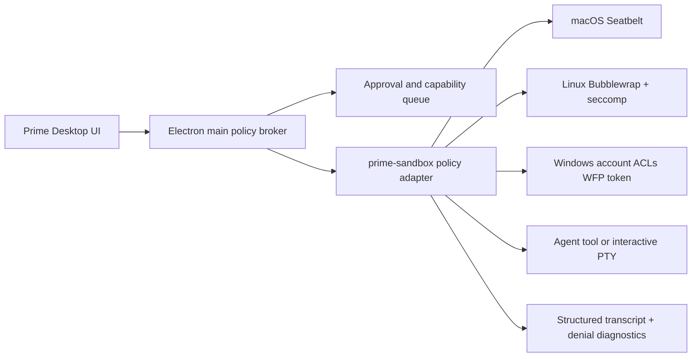

# Cross-platform sandbox research

Status: research review / implementation not started  
Scope: Prime Desktop execution boundary across macOS, Linux, and Windows.

## Executive read

Prime Desktop exposes multiple unsandboxed paths: daemon `executeBash()`, direct
`node-pty`, renderer-to-PTY `terminalWrite`, binary install/discovery, renderer-
selected cwd/skill sources, session gist export, self-update, and `openExternal`.
`permissions.ts` is dead approval code, not enforcement; `BrowserWindow` has
`sandbox: false`; AccessPicker is decorative. Protect against rogue model output
and malicious repo content; renderer compromise and startup supply chain need
separate hardening. Never imply "sandboxed" while any path can escape the project.

Codex is the strongest reference for enforcement, not for copying its whole
agent runtime. Its model is a policy-driven native executor with OS-specific
backends, default-deny network, scoped writable roots, approvals, bounded
output/time, and fail-closed capability detection.

## What the references actually contribute

| Reference | Valuable idea | Do not copy blindly |
|---|---|---|
| [OpenAI Codex](https://github.com/openai/codex) | Native sandbox runner; Seatbelt on macOS; Bubblewrap plus seccomp on Linux; restricted-token/elevated backends on Windows; split filesystem policies; extra-permission requests stay sandboxed. | It is a large Rust workspace with platform-specific test infrastructure. A TypeScript wrapper around `spawn()` is not equivalent. |
| [Codex Linux sandbox](https://github.com/openai/codex/blob/main/codex-rs/linux-sandbox/README.md) | Read-only root by default, explicit writable roots, protected `.git`/metadata, network namespace isolation, startup diagnostics, WSL2 support, and fail-closed unsupported cases. | Landlock-only fallback should not become our "works everywhere" excuse; weaker semantics must be visible and gated. |
| [Codex Windows backend](https://github.com/openai/codex/blob/main/codex-rs/sandboxing/src/windows.rs) | Restricted tokens and elevated enforcement are distinct; exact split policies can fail closed when Windows cannot preserve semantics. | Windows ACL/token behavior is subtle and needs native integration tests on real Windows, not Wine-only confidence. |
| [Claude Code](https://code.claude.com/docs/en/sandboxing) | Publicly documents Seatbelt/Bubblewrap, proxy-filtered network, credential deny/mask rules, and `failIfUnavailable`; native Windows is unsupported. | Default startup is fail-open unless `failIfUnavailable: true`; Bash descendants and built-in file tools use separate controls. Do not call it whole-agent isolation. |
| [Anthropic sandbox-runtime](https://github.com/anthropic-experimental/sandbox-runtime) | Reusable Node-facing runtime for arbitrary processes and MCP servers; macOS Seatbelt, Linux Bubblewrap, proxy network, violation monitoring, and an alpha Windows backend. | Windows is alpha and its filesystem/egress model differs from Unix. Treat it as an adapter candidate, not a security certification. |
| [jcode](https://github.com/1jehuang/jcode) / [Kimi Code](https://github.com/MoonshotAI/kimi-code) | Borrow jcode's persistent/reconnectable harness and Kimi's approvals, Plan mode, subagents, hooks, and packaging. | Their public safety docs show approval/audit and shell portability, not OS isolation; Windows lifecycle/IPC is not filesystem enforcement. |

The referenced projects are open source, but their licenses differ: Codex is
Apache-2.0 and jcode is MIT. Prime Desktop's README still says no license is
selected; resolve that before shipping or vendoring code.

## The Bubblewrap question

Bubblewrap cannot be the backend everywhere. It builds Linux kernel namespaces
(`CLONE_NEWUSER`, mount, PID, network) and depends on Linux user-namespace
capabilities. It is not a macOS or Windows primitive. A portable product should
share a policy schema and executor protocol, not force one kernel mechanism.

The closest cross-platform candidate is Anthropic's `sandbox-runtime`: one Node
package, Seatbelt on macOS, Bubblewrap on Linux, and a Windows alpha using a
dedicated local account, ACLs, a restricted token/job object, and a WFP egress
fence. This is a spike candidate, not a security certification; Windows needs
escape/conformance tests and may require admin machine-state changes.

## Product direction

Prime should feel like a **workbench with a visible trust boundary**:

- Lead with a denial ledger: what failed, missing capability, exact grant, and
  whether retry preserves the boundary; delete or wire the existing AccessPicker.
- Every session has a named policy: `Read only`, `Workspace`, or `Elevated once`.
- The header continuously shows effective filesystem, network, and approval
  state; no hidden "full access" default.
- A blocked action becomes a useful event: what failed, which capability is
  missing, what exact extra access would grant, and whether retry preserves the
  sandbox.
- The review surface joins command approvals, pending capability requests,
  changed files, and the session transcript. "Approve" is never a vague
  permanent bypass.
- Target one executor and policy for terminal and model tools. If PTY isolation
  fails, ship protected non-interactive execution plus a visibly unsandboxed PTY.

## Recommended architecture

Do not implement enforcement in the renderer or by filtering command strings.
Add a stable `prime-sandbox` contract and backend adapter layer. For the first
spike, evaluate Anthropic's runtime behind that contract; retain a Codex-style
native helper path if its Windows semantics or process model are insufficient.
Electron main owns policy, lifecycle, approvals, and diagnostics; the backend
owns OS enforcement.

The policy should be declarative and path-based: filesystem read/write roots,
denied carve-outs, network mode (`none`, `proxy-only`, `restricted`),
environment allowlist, process limits, output cap, timeout, and PTY mode.
Translate one policy into three native backends. If a backend cannot preserve
the requested semantics, refuse to run and explain why.

## Phased plan

0. **Portability baseline:** make paths, shells, sockets, packaging, and binary
   discovery/install cross-platform; app launch on real target runners is the gate.
1. **Contract/evidence:** add runner, three-OS CI, policy schema, capability
   states, denial events, and pass/fail probes; never label protected until pass.
2. **Backend spike:** run macOS/Linux `sandbox-runtime` in parallel with J0;
   test Windows alpha, admin requirements, proxy, and PTY as explicit go/no-go.
3. **Windows decision:** choose alpha, Codex-style token backend, WSL2, or VM;
   native Windows fails closed until real filesystem/child/env/egress probes pass.
4. **Unify execution:** route daemon and PTY through the helper; remove dead
   permission matching and add binary provenance checks.
5. **Trust UX:** add denial ledger, effective-policy header, request detail,
   one-shot approval, denial explanation, and a searchable audit transcript.
6. **Promotion:** package signed helpers, publish a support matrix, and require
   automated escape probes plus clean-machine smoke tests before enabling the
   default workspace policy.

## Non-negotiable gates

- Renderer input reaches a shell only inside enforced policy; main validates all
  IPC payloads, hardens navigation/external URLs, and never trusts renderer cwd,
  command, or binary paths.
- Network is denied by default; capability escalation is scoped and expiring.
- Secrets and auth files are denied by policy, not merely hidden in UI.
- PTY, child processes, symlinks, metacharacters, env allowlists, and installer
  provenance are tested as escape surfaces.
- "Sandboxed" means authoritative OS enforcement passed a probe on that host.
- Every weaker fallback is explicit, logged, and never silently promoted.

## Decision

Adopt a portable policy layer with OS-native backends. Borrow Codex for
enforcement, Claude's runtime as a spike candidate, and jcode/Kimi for
session/product ergonomics. Do not fork any project wholesale, and do not make
the first milestone "all features"; make it one reliable, inspectable
execution boundary used everywhere.

### Sources

- [Codex repository/license](https://github.com/openai/codex) · [Linux sandbox](https://github.com/openai/codex/blob/main/codex-rs/linux-sandbox/README.md)
- [Codex Windows backend](https://github.com/openai/codex/blob/main/codex-rs/sandboxing/src/windows.rs) · [app-server](https://github.com/openai/codex/blob/main/codex-rs/app-server/README.md)
- [Codex Seatbelt](https://github.com/openai/codex/blob/main/codex-rs/sandboxing/src/seatbelt.rs) · [Bubblewrap](https://github.com/containers/bubblewrap)
- [jcode server](https://github.com/1jehuang/jcode/blob/master/docs/SERVER_ARCHITECTURE.md) · [safety](https://github.com/1jehuang/jcode/blob/master/docs/SAFETY_SYSTEM.md) · [Windows](https://github.com/1jehuang/jcode/blob/master/docs/WINDOWS.md)
- [Claude Code sandboxing](https://code.claude.com/docs/en/sandboxing) · [Anthropic containment](https://www.anthropic.com/engineering/how-we-contain-claude)
- [Anthropic sandbox-runtime](https://github.com/anthropic-experimental/sandbox-runtime)
- [Kimi tools](https://github.com/MoonshotAI/kimi-code/blob/main/docs/en/reference/tools.md) · [configuration](https://github.com/MoonshotAI/kimi-code/blob/main/docs/en/configuration/config-files.md)
- [Kimi command modes](https://github.com/MoonshotAI/kimi-code/blob/main/docs/en/reference/kimi-command.md) · [Kimi CLI transition](https://github.com/MoonshotAI/kimi-cli)

Sources checked 2026-08-13; moving `main`/`master` refs must be pinned at spec time.
