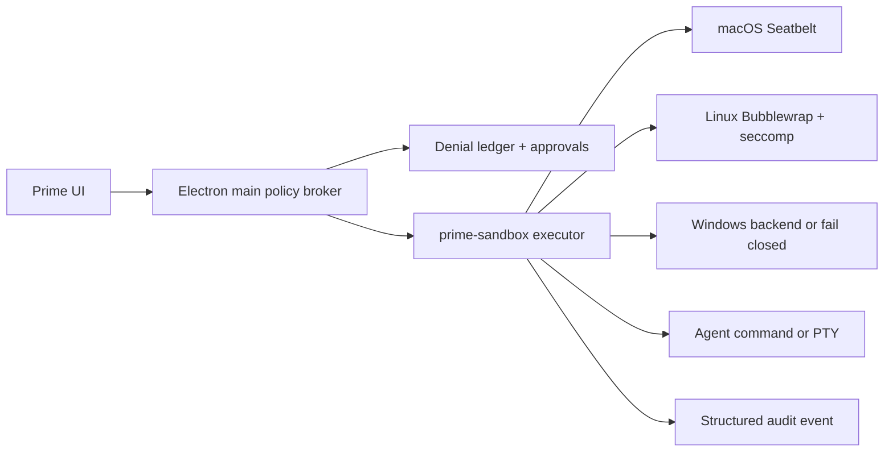

# Cross-platform sandbox implementation job spec

Status: cleared for bounded implementation work; no code started.  
Authority: research review plus Claude Opus review, both in `docs/reviews/`.

## Objective

Give Prime Desktop one inspectable execution boundary for model tools and the
interactive terminal, with OS-native enforcement and honest capability states
across macOS, Linux/WSL2, and Windows.

Scope boundary: this protects rogue model output and malicious repository
content. Renderer compromise and Electron/startup supply chain are adjacent
hardening gates owned here only where they can bypass the execution broker.

## Non-goals

- Fork Codex, Claude Code, jcode, or Kimi wholesale.
- Claim whole-agent isolation from a child-process sandbox.
- Enable native Windows protection before native probes pass.
- Preserve the existing decorative access picker unchanged.

## Product contract

The user sees an effective policy, not a vague permission mode:

- `Read only`: read project, no writes, network denied.
- `Workspace`: write declared workspace roots, network denied by default.
- `Elevated once`: one expiring capability grant with exact scope and audit.
- Every denial explains the missing capability and whether retry remains inside
  the same boundary. Protected mode never silently falls back unsandboxed.
- Until an authoritative probe passes, preserve the honest copy: workers run
  with user permissions and are not a security sandbox.

## Enforcement contract

`ExecutionPolicy` is declarative: read/write roots, denied carve-outs, network
mode (`none`, `proxy-only`, `restricted`), environment allowlist, process/PTY
limits, output cap, timeout, `grantExpiresAt` for elevated access, and protected
metadata paths.

`ExecutionRequest` accepts argv, a main-resolved cwd, policy, and PTY intent.
No renderer string is authoritative for cwd, binary, environment, or policy.
The enforcement unit is a resident `prime-agent` daemon, not a per-command
child; each daemon serves exactly one policy scope, or execution moves to a
per-command child. Protected sessions never attach to an unverified daemon.

`ExecutionResult` returns exit state, backend, enforcement state, denial events,
bounded stdout/stderr, and diagnostics suitable for the audit ledger.

## Implementation jobs

| Job | Scope | Deliverable | Acceptance gate |
|---|---|---|---|
| J0 | Portability baseline | `userData` paths, shell resolver, path delimiter, named pipes/UDS, packaging matrix, binary discovery/install policy | App launches on real macOS/Linux/Windows runners; no hardcoded POSIX runtime paths |
| J1 | Test substrate | runner, fixtures, named three-OS CI matrix, temp workspace helpers, capability probes | CI runs assertions; unsupported host reports `unavailable`, never `protected` |
| J2 | Main broker + renderer hardening | policy/request/result types, IPC validation, lifecycle, audit events, navigation/CSP/external-URL decisions, integrity-checked main-process module loading | Threat model is enforced at the seam; malformed payloads and bypass attempts fail closed |
| J3 | Backend spike | sandbox-runtime adapter for macOS/Linux; Windows alpha probe; SHA-pinned dependency review | After J1, expected-allow and expected-deny probes pass on real OS runners; results include `enforced` state |
| J4 | PTY decision | PTY-in-boundary experiment, ConPTY/account test, explicit fallback UX | Go/no-go recorded; no UI claims PTY is protected unless probe passes |
| J5 | Execution migration | daemon Bash and terminal route through broker; installer, update, skill, gist, and external-URL paths classified; daemon attach attestation and lifecycle bound to policy state | Every execution returns `enforced`/`unenforced`; no unlabelled bypass; env allowlist including socket client environment and provenance enforced; no attach to an unverified daemon |
| J6 | Trust UX | effective-policy header, denial ledger, one-shot grant, honest terminal label | AccessPicker is removed or authoritative; fix approval/license strings; every state maps to main policy |
| J7 | Promotion | signed helpers, Electron supply-chain review, clean-machine smoke, escape suite, support matrix | Default workspace mode only enables on passing host probe; weaker modes explicit |

## Backend rules

- macOS: Seatbelt profile generated from the policy; verify child inheritance.
- Linux/WSL2: Bubblewrap plus seccomp; fail closed when required primitives are
  unavailable. WSL1 is unsupported for protected mode.
- Windows: test sandbox-runtime alpha and a native restricted-token option;
  account/ACL/WFP installation privileges and machine-state mutations are part
  of the decision. No protected label until real Windows probes pass.
- Fallback: sandboxed non-interactive execution plus visibly unsandboxed PTY,
  or no execution. Never silently widen access.
- Product decision: if PTY is no-go, protected agent execution remains useful;
  the terminal is explicitly labeled unsandboxed. Do not hide this tradeoff.

## Security probes

Each backend must pass expected allow/deny tests for: outside-root read/write,
denied carve-outs, symlink escape, child/grandchild inheritance, shell
metacharacters, environment scrubbing, network DNS/egress, timeout/output
caps, PTY behavior, and protected `.git`/metadata. Also test installer/update
redirect depth/host/checksum/signature provenance, session gist egress, and
scheme-allowlisted `openExternal`. Include adoption of a pre-existing daemon on
the known socket and re-adoption after app quit.

The inventory includes `shareSession` gist export, `harnessAction('update')`,
and `shell.openExternal`; these are main-process egress/provenance paths, not
automatically covered by child network policy.

Electron supply-chain gates include the configured download mirror/checksum
source, integrity verification before main-process `import()` from the
prime-agent install tree, and macOS entitlements before promotion. The helper
and host process must not inherit credentials or unsafe loader variables by
default.

## Delivery and review

J0/J1 can proceed in parallel. J3 macOS/Linux can run in parallel with J0 but
cannot close its gate before J1;
Windows J3/J4 depend on Windows portability. J2 is the integration seam. J5
depends on J2, J3, and the J4 decision; J6 depends on J2/J4. J7 requires
independent security review, real OS runs, and a support matrix. No job may
call a permission prompt an OS sandbox, and no green typecheck substitutes for
passing escape evidence.
